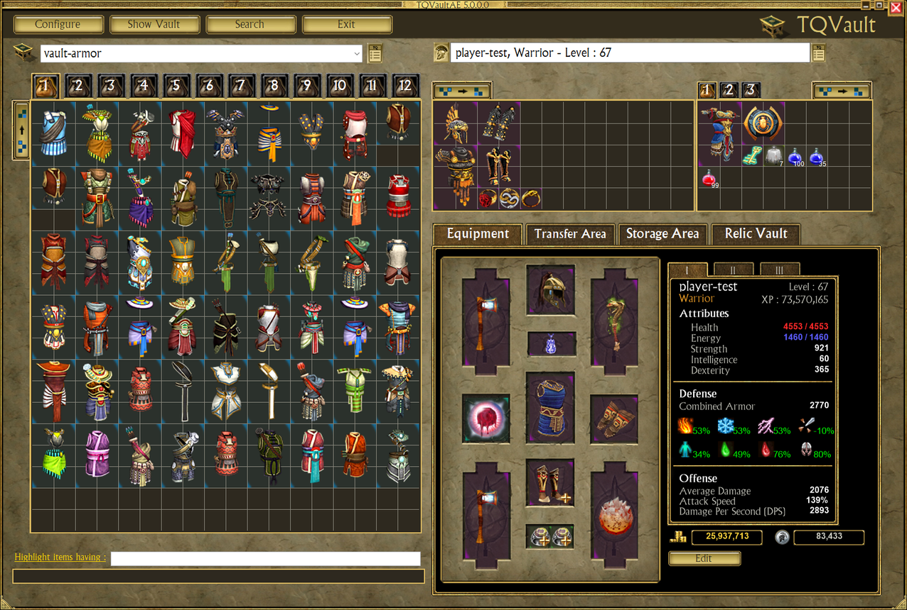

# TQVaultAE

TQVaultAE is an external tool for [Titan Quest Anniversary Edition](https://www.thqnordic.com/games/titan-quest) that allows you to store and search your items outside the game.
Works with all expansions!

## Features
- **Infinite bank space**
- [Share / Import items](documentation/IMPORT_EXPORT.md) — share items, tabs, and vaults via clipboard, `.json` files, or PasteBin URLs.
- [Powerful search](documentation/ADVANCEDSEARCH.md)
- Cheats 
    - Items
        - [Extract relic/charm from items at no cost, keeping both](documentation/AFFIXES.md#relics-removal)
        - [Modify the relic/charm/artefact completion bonus](documentation/AFFIXES.md#relic-and-charm-completion-bonus-change)
        - [Complete relic/charm from a single piece](documentation/AFFIXES.md#relic-and-charm-completion)
        - [Craft an artifact from its recipe](documentation/AFFIXES.md#artefact-creation)
        - [Change item seed](documentation/AFFIXES.md#item-seed-change)
        - [Create missing set pieces](documentation/AFFIXES.md#create-missing-set-pieces)
        - [Craft custom items](documentation/FORGE.md)
        - [Change items affixes](documentation/AFFIXES.md#prefix-change)
        - Duplicate any item
    - [Characters](documentation/CHAREDIT.md)
        - Read the character window statistics (resistances, damage, DPS, ...)
        - Edit masteries and skills in the game's skill window
        - Redisribute attribute points
        - Unlock difficulties
        - Level up
- [Support of Titan Quest 2006](documentation/TQORIGINAL.md)
- QOL
    - [Cloud saving](documentation/GITBACKUP.md)
    - Bulk item transfer
    - [Highlight items](documentation/HIGHLIGHT.md)
    - [Compare two items](documentation/ITEMCOMPARE.md)
    - Combine stacks (potions, relics and charms) by dropping them onto each other
    - Split potion stacks apart
    - [Many keyboard shortcuts](documentation/SHORTCUTS.md)
    - Window zoom (<kbd>CTRL</kbd>+<kbd>+</kbd>, <kbd>CTRL</kbd>+<kbd>-</kbd>, <kbd>CTRL</kbd>+<kbd>Home</kbd>), sharp on high DPI screens
    - Tool tips with the values the item has in game (the "Show In-Game Values" setting, on by default)
- [Character management](documentation/CHARMANAGE.md)
- [Mods (custom maps)](documentation/MODS.md) — modded characters, items and vaults shown with their own mod's data, next to the regular ones. See also [how the mod link works](documentation/MODLINK.md).
- Character backups
    - If an error occurs, backups are located at `My Documents\My Games\Titan Quest\TQVaultData\Backups` (the `Backups` folder of your vault folder)
- External tools
    - [ARZ Explorer](documentation/ARZEXPLORER.md) : Game resource file exploration
    - [DB CLI (`tqdb`)](documentation/DBCLI.md) : Command-line search of the game database and archives, with JSON / TSV / raw asset export
    - [Save File Explorer](documentation/SAVEFILEEXPLORER.md) : Game save file exploration
    - [Game file formats](documentation/tq-file-formats.md) : Technical reference of the `.arc` / `.arz` / `.tex` formats and item stat randomization

## Installation

1. Navigate to the [release page](https://github.com/EtienneLamoureux/TQVaultAE/releases)
2. Download the latest release's `TQVaultAE.GUI-<version>.zip` file. It runs on Windows x64 and includes the .NET runtime, so nothing else needs to be installed.
3. Extract the content of the archive on your computer.
4. Navigate to the folder where you extracted the artefacts. Double-click `TQVaultAE.exe`
5. Enjoy!

## Configuration
The "Configure" button (top-left) opens up the configuration menu. That's where you can change:
- The language used by the application
- The paths where the vault files are located
- The paths where the game files are located
- The font, the sounds and the tool tips ("Show In-Game Values", "Tooltip Enhanced"). In "Tooltip Enhanced", "Enable detailed view" splits the item tool tip into prefix, base and suffix sections; the other options (in-game rolls, min/max values, item skills, set piece counts) apply to both the classic and the detailed view
- The cheats: the "Allow Cheats" group holds character editing, item editing and item copying (see the F.A.Q. below)
- The hot reload features, [Git Backup](documentation/GITBACKUP.md), [TQ original support](documentation/TQORIGINAL.md), the [PasteBin integration](documentation/IMPORT_EXPORT.md) and the CSV delimiter of the search export

Every vault button can be customized using in-game pictures: right-click a bag button and choose "Change icon".

## Troubleshooting and F.A.Q.

See [Troubleshooting and F.A.Q.](documentation/TroubleshootingAndFAQ.md)

## Contributors
This project could not go on without the continued volunteer contributions of the Titan Quest community. If you're thinking about contributing, please read our [contributing guidelines](/CONTRIBUTING.md).

### TQVaultAE
- [Open-source contributors](https://github.com/EtienneLamoureux/TQVaultAE/graphs/contributors)

### TQVault

- Brandon "bman654" Wallace, *original author*
- saydc, *item stats*
- Jesse "VillageIdiot/EJFudd" Calhoun, *item stats & ARZExplorer util*
- AvunaOs, *new UI*

#### Translation team

- FOE, *german*
- Jean, *French*
- Vifarc, *French*
- Cygi, *Polish*
- Xelat, *Russian*
- Kurrus, *Spanish*
- Klauhs, *Portuguese*

## Disclaimer
Titan Quest, THQ and their respective logos are trademarks and/or registered trademarks of THQ Nordic AB. This non-commercial project is in no way associated with THQ Nordic AB.
