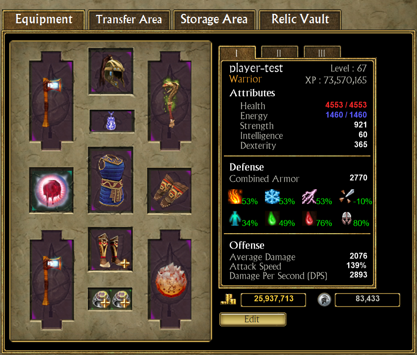
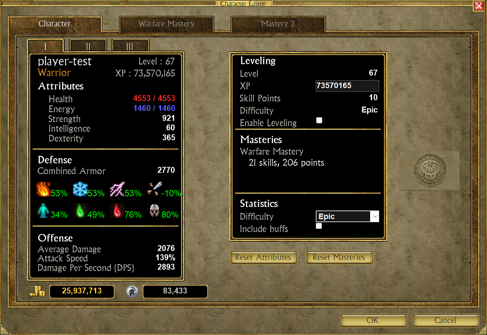
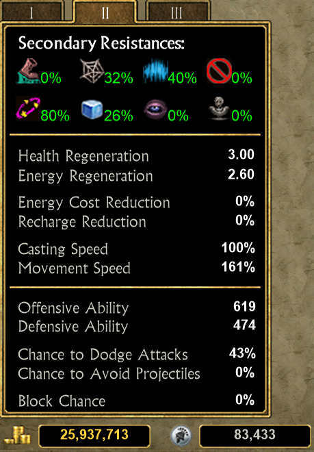
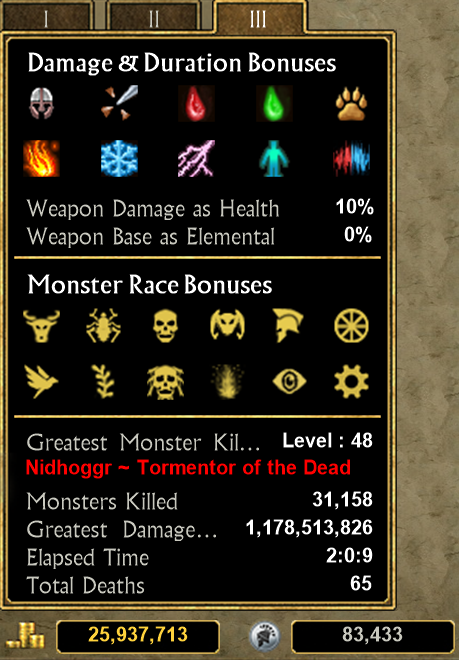
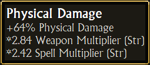
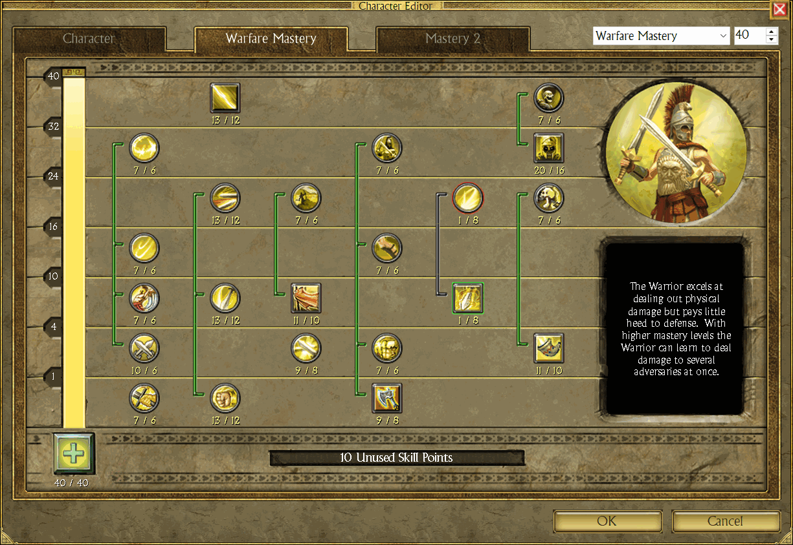
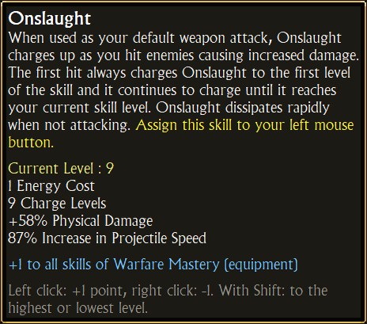

# Character editor

Edit a character's attributes, masteries and skills in a window drawn like the game's, and read the statistics of the
game's character window without starting the game.

> **Note:** this is a "character editing" feature. Enable it in the settings window: tick **Allow Cheats**, then
> **Allow Character Editing Features**. Do not edit a character that is loaded in the game.

## In the main window

The **Equipment** tab shows the same statistics panel next to the equipment, read only: tabs **I**, **II** and **III**,
with the gold and the Electrum under it. Hover an icon or a value for its details. It follows the equipment: equip or
remove an item and the values change. Nothing can be changed there; the **Edit** button under it opens the editor.

The panel shows whether or not character editing is enabled; only the **Edit** button needs the setting. It counts
the resistances for the highest difficulty the character has unlocked, and no buffs.

## Open it

1. Select a character.
2. Click **Edit** under the statistics panel of the **Equipment** tab.

Nothing changes before **OK**. **Cancel** drops every change. **OK** changes the character loaded in TQVault; the
file is written when TQVault saves, as for any other change.

## Character page

The left panel is the game's character window, with its three tabs **I**, **II** and **III**. The right panel holds
the editing options.

### Attributes

While attribute points are left, a `+` button shows next to each attribute. The clicks below are on that button:
once the last point is spent it goes away, and **Undo** or **Reset Attributes** are the way to get points back.

| Click on `+` | Effect |
|---|---|
| Left | Spends one point |
| Right | Takes one point back |
| Shift + left | Spends all the points |
| Shift + right | Back to the starting value |

**Undo** puts the attributes back as they were when the editor opened. It is the game's button: it takes the place
of the "Attributes" title once an attribute has changed.
**Reset Attributes** gives back every point spent since level 1.

### Leveling

Tick **Enable Leveling** to change the level and the unlocked difficulty. The XP is set to the first XP of the
level, and a level change adds or removes the attribute and skill points that go with it. The option is hidden for a
character that has never been in the game.

### Masteries

The list shows each mastery with its number of skills and points; the mastery itself counts as one skill.
**Reset Masteries** removes both masteries and refunds their points.

## Statistics

The values are computed with the game's formulas from the attributes, the equipped items, the item sets and the
skills.

| Tab | Shows |
|---|---|
| I | Attributes, combined armor, main resistances, average damage, attack speed, DPS |
| II | Secondary resistances, offensive and defensive ability, chances to dodge, to avoid projectiles and to block, regeneration, energy cost and recharge reduction, casting and movement speed |
| III | Damage and duration bonuses, monster race bonuses, play statistics |

 

Hover an icon or a value for its details, as in the game:

Two options change what is counted:

| Option | Effect |
|---|---|
| **Difficulty** | The difficulty played: Epic and Legendary lower the resistances |
| **Include buffs** | Counts the auras and buffs of the skills as if they were active; else only the passive skills count |

## Mastery pages

One page per mastery, laid out like the game's skill window.

Choose the mastery and its level with the two boxes at the top right, or click the `+` button under the mastery bar,
which takes the same four clicks as a skill.

- An empty slot is a page named "Mastery 1" or "Mastery 2", with "(None)" in the list: it shows the skill window
  without a tree.
- A new mastery starts at level 1, so it needs one free skill point. The mastery of the other page is refused.
- Changing or removing a mastery gives back all its points.
- Lowering the mastery level resets the skills of the tiers it closes.
- Changing the masteries clears the class name; the game sets it again.

| Click on a skill | Effect |
|---|---|
| Left | +1 point |
| Right | -1 point |
| Shift + left | Highest level the points allow |
| Shift + right | Lowest level |

The game's rules apply: a skill needs its mastery tier and the skill before it.

The number under a skill reads `level / maximum`. The level includes the bonuses of the equipment, so it can exceed
the maximum.

The border of a skill tells its state:

| Border | Meaning |
|---|---|
| Green | A point can be added |
| Gold | No point left |
| Blue | At its maximum |
| Gray | Mastery level too low |
| Red | Needs the skill before it |

Hover a skill for the game's tool tip, with the bonus coming from the equipment:

The bar at the bottom shows the unused skill points.
