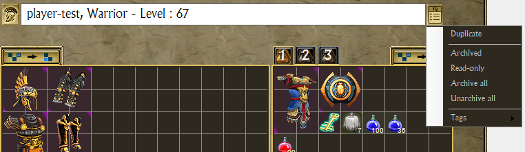
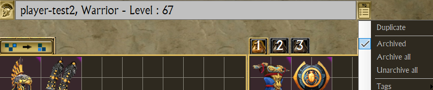
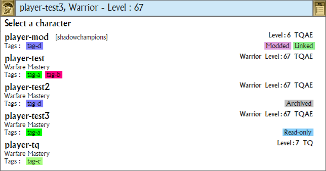

# Character Management

Over time, the number of character saves is growing.
It can be a real chore to scroll through all your characters in the character selection screen of the game.

TQVault let you decide which characters can be loaded in the game and can safely put on the bench the others.

***Note : This feature should not be used on characters that are loaded in game. 
To avoid any trouble, go back to the MAIN screen (NOT the character selection screen).***

## Menu
You can access these features from the button on the right of the character dropdown.

For a character of a custom map, the menu also has "Mod link..." after "Duplicate": see [Mods](MODS.md).

## Duplicate character

TQVault will prompt you for a new name and create a copy of the selected character.

***Note : This is a "character editing" feature: the entry only shows with "Allow Cheats" and "Allow Character Editing Features" ticked in the settings.***

## Archiving

An archived character shows an "Archived" badge in the dropdown, and its box turns silver when it is selected.

*"Archived"* is a toggle.

*"Archive all"* & *"Unarchive all"* apply to all your characters, not only the selected one.

## Read-only

*"Read-only"* is a toggle. It sets or clears the Windows read-only attribute of the files TQVault writes for the
character: `Player.chr`, its storage area (`winsys.dxb` and `winsys.dxg`) and its mod link file. A character is
read-only as soon as one of these files is read-only, also when the attribute was set outside TQVault (in the file
Explorer, or by a download).

Nothing of a read-only character can change in TQVault: no item can be taken out of its bags, equipment or storage
area, moved, deleted, sorted or edited (seed, affixes, relics, forge), no item can be put in, its character editor
only shows it (OK is disabled) and its mod link cannot change. TQVault tells why in the notification bar. Copy, Share,
Properties and Compare still work, and the save skips the character. The dropdown shows a "Read-only" badge on it, and its box turns icy blue when it is selected.

The transfer stash and the relic vault belong to every character: they stay writable.

TQVault does not make a character read-only while it has unsaved changes: save them first. A duplicate of a read-only
character starts writable.

***Note : the game may fail to save a read-only character: make it writable again before playing it.***

## Tags

TQVault allow you to organize your extensive roster of character by using tags

All tag actions can be done from this menu.

You can also "Archive/Unarchive" your characters by tag.

## Detailed dropdown

The character dropdown display detailed informations on the characters, including tags.

It make it easier to manage your roster.

The status badges sit on the right of each entry: "Archived", "Read-only", and for a character of a custom map a "Modded"
badge with the state of its mod link, its mod named in brackets beside its name (see [Mods](MODS.md)). The tags line
keeps only the tags. The selected character's box turns icy blue when it is read-only, silver when it is archived.

