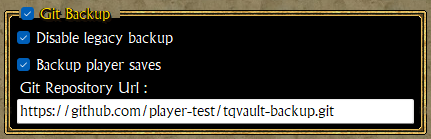

# Cloud Saving

TQVault provide a cloud saving system.

Why that?! We already have Dropbox, Google Sync, etc...

Because we can!

This backup system use **Git**. So TQVaultAE provide ***Versioning*** to your precious vault files and character save files.
That mean 4 important things.

1. You can recover your saves even if your home burn with your computer and your backup hard drives in it.
1. You can sync your local computer with your latest vaults and character saves everytime you run TQVault. Useful when you use different computers often.
1. You can retrieve an older version of your vaults or character saves by using regular git commands or a git UI.
1. You can share your repository with your friends, (e.g. play the same save with your friend in a group speed run marathon challenge?)

You can use a public git repository provider (Github, GitLab, etc...) or your own git server if you have one.

---

## Table of contents
1. [BACKUP BEFORE DOING ANYTHING](#Backup)
1. [Setup](#Setup)
1. [Settings](#Settings)
1. [Workflow](#Workflow)
1. [DO NOT MESS WITH YOUR REPO](#DONOT)
1. [Recover an old version of a vault or a character save](#Recover)

---

### BACKUP BEFORE DOING ANYTHING
It's a no-brainer! Before trying to use this feature, you **SHOULD** backup your precious files.
Just in case something's going wrong!

Here's the locations.

- TQ Saves : `%USERPROFILE%\Documents\my games\Titan Quest`
- TQIT Saves : `%USERPROFILE%\Documents\my games\Titan Quest - Immortal Throne`
- TQVault Data : `Where you put it! (Default : %USERPROFILE%\Documents\my games\Titan Quest\TQVaultData)`

---

### Setup

***Note : We explain the main steps for this setup, we don't support git related problems or detailed installation howto. Google it!***

1. Create a git(hub) account.
1. Create a repository.
1. Install [Git for windows](https://gitforwindows.org/) on your machine.
1. Optional : Install a Git UI like [Git Extensions](https://gitextensions.github.io/) or [GitKraken](https://www.gitkraken.com/) (they are many)
1. Check your configuration
    1. Make sure your can `clone` and `push` your repository from the console `CMD.exe`.
    1. Resolve authentication problems if you have any.
1. Configure TQVault "Git Backup" from it's [setting windows](#Settings).
1. The tool should restart.

---

### Git Backup settings

- ***Disable legacy backup*** : stops the existing local backup system in `$(TQVaultData)\Backups`.
    - That folder is not sent to the git repository: git already keeps every version of your files.
    - It can contain a lot of files. So if you decide to check this box, you certainly can empty it first.
- ***Backup player saves*** : this backup is optional, the main concern is vault files.
    - Always backed up: the vault files of your vault folder (`*.vault.json` and the old `*.vault`) and its `Config` folder.
    - With this box: also the whole `SaveData` folder of `Titan Quest` and of `Titan Quest - Immortal Throne`.
- ***Git Repository Url*** : if you arrived here, you know what it is. If you don't google it.
    - You can change it later: the next start uses the new repository and sends it all your files.

---

### Workflow

1. Once configured, the first time, TQVault clones your repository into a sub directory of TQVault named `LocalGitRepository`.
    1. The clone holds **copies** of your files. git only works inside it: TQVault alone reads and writes your real folders, file by file.
    1. Your files and the repository's are put together: a file found on one side only is kept, and a file found on both sides keeps the most recent save.

1. You update your files from TQVault or the game.

1. On closing, TQVault copies your changes into the clone (new, changed and deleted files), commits them, brings in what another computer pushed meanwhile, and pushes.
    1. For those who have a lot of saves, it may be long to push all the files in the remote location. The first time may be annoying.
    1. ***Taking a long time uploading 2GO via a DSL line is not a TQVault issue***.
    1. Beside that "first time" it should be fast.

1. On opening, TQVault copies and commits your changes and brings in what the other computers pushed (it does not tag or push then), then writes the changes of the other computers to your folders. No question is asked:
    1. A file changed on one computer only takes that version. A file deleted on another computer is deleted here too.
    1. A file changed on both computers keeps the **most recent save**. git does not keep file dates, so every commit carries a small `.tqvault-savetimes` file with the real save time of each file, and a file written from the backup gets its original date back.
    1. A file modified on one computer and deleted on the other is kept.
    1. Files are always taken whole, never mixed.
    1. If your vault folder (or a save folder) is empty while the backup holds files, for example after a reinstall or a new vault path, it is filled from the backup instead of emptying the backup.

1. If git is not installed, or the repository cannot be reached, TQVault shows the error and keeps working without the backup.

---

### DO NOT MESS WITH YOUR REPO

***Stupidity is not a TQVault issue.***

Your real folders are the reference: on opening and closing, TQVault copies them into `LocalGitRepository`.
So editing files inside `LocalGitRepository` does nothing, the next sync puts your real files back.

if you think you misbehave, remember TQVault sync your changes on opening and closing.
So if you did a mess, manually backup your local files before running the tool again.

We don't take responsibility. 

---

### Recover an old version of a vault or a character save

TQVault use a strict taging based on date time `yy.MM.dd.HHmmss` and the last commit is always tagged `latest`.

These tags are also pushed on the remote repository.

This make it easy to get a file (or several) back in a previous state.

TQVault closed, copy the old version of the file into your vault folder (or save folder), for example with
`git show 26.11.08.161633:"TQVaultData/MyVault.vault.json" > "%USERPROFILE%\Documents\my games\Titan Quest\TQVaultData\MyVault.vault.json"`
from `LocalGitRepository`, or with the "save as" of your git UI. The next start shows it and backs it up as a new change.

Here's where to find the old version of a vault in Git Extensions. Use "Save selected as...", not the "Reset file(s) to" entry the picture highlights: a file reset inside `LocalGitRepository` is put back by the next sync.

