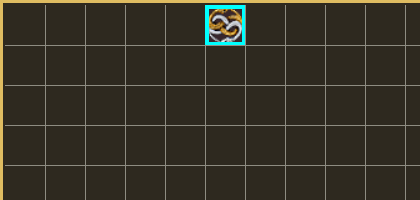
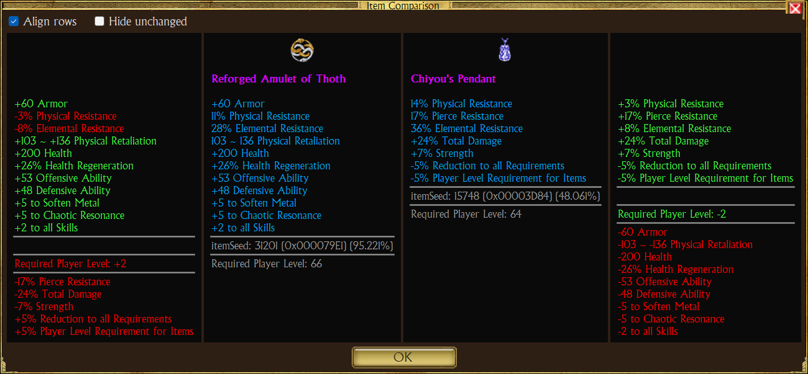
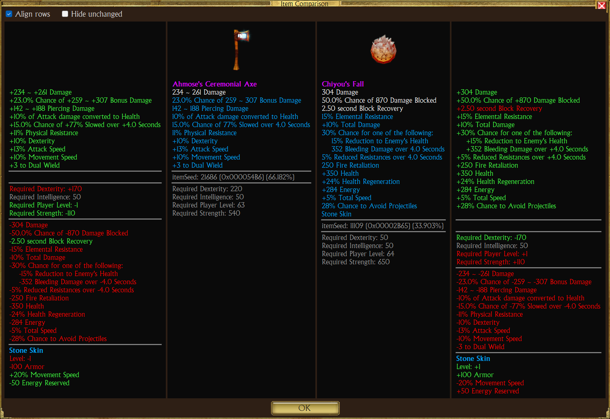
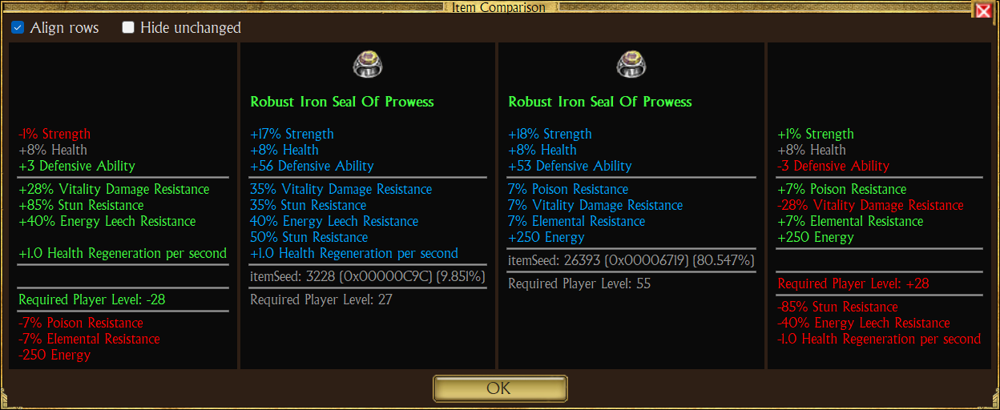
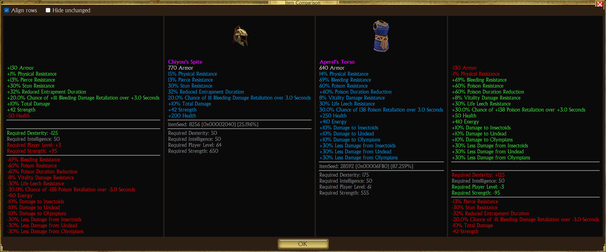
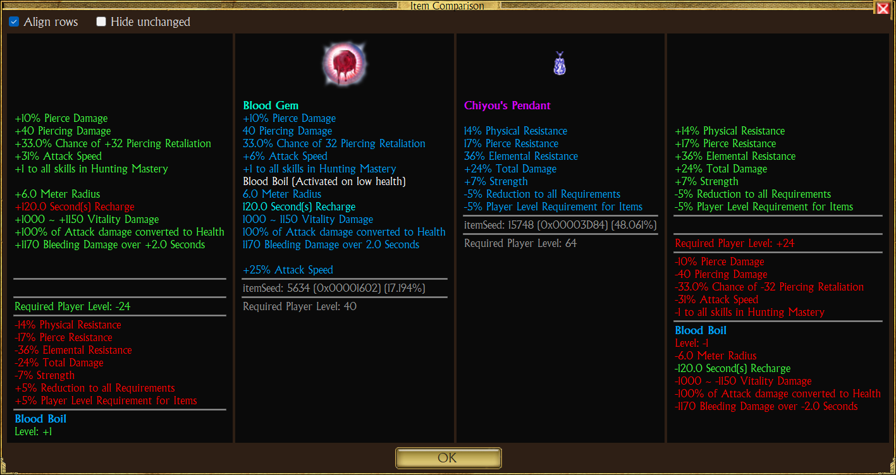

# Item comparison

Compare two items side by side, stat by stat.

## Open it

1. Ctrl+Click two items in the same panel (vault, secondary vault, stash or player sacks).
2. Right-click one of them, then **Compare**.

With more than two items selected, only the first two are compared.

## Layout

Four columns, left to right:

| Column | Shows |
|---|---|
| Diff 1 | Item 1 minus item 2 |
| Item 1 | Picture and tooltip of the first item |
| Item 2 | Picture and tooltip of the second item |
| Diff 2 | Item 2 minus item 1 |

## Reading the differences

- Values are the displayed ones, so **Show In-Game Values** applies.
- A stat on both items shows the difference: `+12 Strength`.
- A stat on one item only shows in full: plus on its side, minus on the other.
- Equal stats are left out.
- Relics, charms and completion bonuses add to the item's own stats.
- Granted skills are compared in their own group.
- Requirements come last; lower is better there.

Colors:

| Color | Meaning |
|---|---|
| Green | Better for this column's item |
| Red | Worse |
| Yellow | Mixed (some numbers up, some down) |

## Examples

Weapons, one granting a skill:

Rings with a charm vs a relic:

Different slots, mostly different stats:

Artifact with a granted skill and completion bonus vs an amulet:

## Limits

- Both items must be in the same panel; equipped items can't be selected.
- Lower-is-better stats (Energy Cost, Recharge, requirement reductions) are colored as if higher were better.
- Text-only stats that differ (`Speed: Fast` vs `Speed: Slow`) show as two lines.
