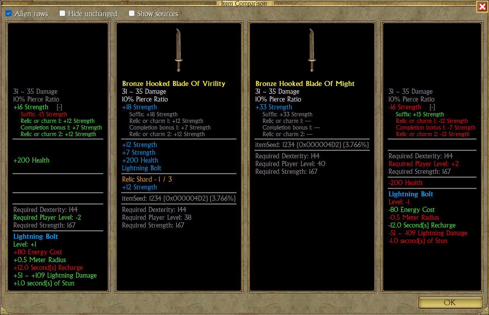

# Item comparison

Compare two items side by side, stat by stat. The two items can be anywhere: vault, secondary vault, player bags,
equipment, stashes, even in two different vaults.

## Open it

1. Right-click the first item, then **Compare**. The item gets an aqua frame, the cursor becomes a hand, and the status
   line says what to do.
2. Left-click the second item, in any panel. The click does not take the item: it opens the comparison.

While waiting for the second item you can switch bags, vaults or characters. <kbd>Esc</kbd> or a right-click cancels;
a left-click on the first item again cancels too; a click on an empty cell does nothing.

## Layout

A toolbar, then four columns, left to right:

| Column | Shows |
|---|---|
| Diff 1 | Item 1 minus item 2 |
| Item 1 | Picture and tooltip of the first item, lines with a number only |
| Item 2 | Picture and tooltip of the second item, lines with a number only |
| Diff 2 | Item 2 minus item 1 |

Toolbar:

| Check box | Effect |
|---|---|
| Align rows | Each difference sits on the row of the item line showing that stat, a granted skill's effects under the skill's name. The stats only the other item has, and those the tooltip does not list (the effects of a skill the tooltip only names), come after, below a line. Unchecked: the differences are listed one after the other, grouped. |
| Hide unchanged | Leaves out the stats both items have with the same numbers. |
| Show sources | Opens the sources of every stat that has some (see [Sources of a stat](#sources-of-a-stat)). |

The choices are saved in `UserConfig.xml` as soon as they change, in one element:
`<ItemCompare AlignRows="1" HideUnchanged="0" ShowSources="0" />` (1 on, 0 off). Without it, rows are aligned,
unchanged stats shown and sources closed.

## Sources of a stat

A stat's total can come from several sources: the base item, its prefix, its suffix, the relic or charm of each slot,
and each completion bonus. Two items can show the same total made of different parts, for example 20% from the
base and 15% from a removable relic against 35% from the base alone.

A stat whose total comes from more than one source, on either item, ends with `[+]` in the difference columns. A click
on the stat (its difference, or its line in the item column) opens one line per source under it, and `[-]` closes
them. **Show sources** opens them all; a click on a stat then closes that one.

- The sources are matched by role: the base item with the base item, the first relic slot with the first relic slot.
- Each source line, in a smaller font, shows in the item column what that source gives on this item (`—` when the item
  has no such source), and in the difference column the difference with the same source of the other item, a source
  missing on one item counting 0. Colors follow the same rules as the totals.
- Rows not aligned: the source lines come under the stat's difference only.
- The totals do not change: closed, a stat shows exactly what it shows without sources.
- With **Hide unchanged**, a stat whose total is the same on both items still shows while its sources are open and
  differ.

## Reading the differences

- Values are the displayed ones, so **Show In-Game Values** applies.
- A stat on both items shows the difference: `+12 Strength`.
- A stat on one item only shows in full: plus on its side, minus on the other.
- A stat with the same numbers on both items shows as the item writes it, in gray.
- Only lines with a number are compared and shown, in the item columns too: lore, set member lists, `Speed: Fast` or
  `Grants Skill :` are left out. The item name, the warnings, the names of granted skills and a text heading indented
  lines with numbers (`Bonus to all Pets:`) stay.
- Relics, charms and completion bonuses add to the item's own stats; their parts show under the total on demand
  (see [Sources of a stat](#sources-of-a-stat)).
- Granted skills are compared in their own group.
- Requirements come last.

Colors:

| Color | Meaning |
|---|---|
| Green | Better for this column's item |
| Red | Worse |
| Yellow | Mixed (some numbers up, some down) |
| Gray | Unchanged |

Lower is better for the requirements and for these stats, so their colors are reversed: energy cost, active energy
cost, life cost, recharge time, energy reserved, shield block recovery, and the reductions written with a minus sign
(`-10% Recharge`, `-10% Energy Cost`, `-15% Strength Requirement for all Weapons`, `-5% Reduction to all Requirements`,
shield recovery time). The list is kept by game attribute name in `LowerIsBetterStats` and matched with the labels of
the current language.

Two items with no difference show "No difference" on top.

## Examples

Weapon against a shield granting a skill (aligned):

The same, rows not aligned and unchanged stats hidden:

Rings with a charm vs a relic:

Different slots, mostly different stats:

Artifact with a granted skill and completion bonus vs an amulet:

## Limits

- The classic tooltip names a granted skill without its effects: with **Align rows**, the skill's differences come
  after the item's lines.
- A stat only one item has is colored by the sign of its numbers: a block recovery time only a shield has shows red on
  the shield's side.
- Sources split only the item's attributes: a granted skill's effects and the requirements have none.
