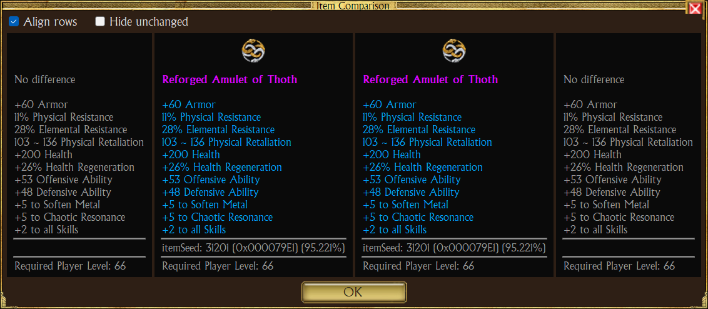
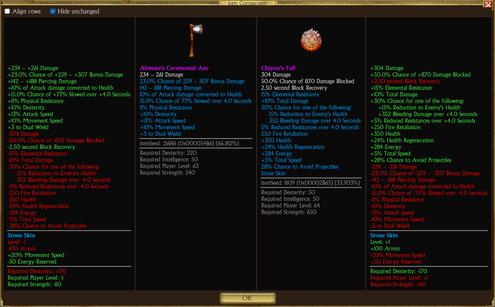

# Item comparison

Compare two items side by side, stat by stat. The two items can be anywhere: vault, secondary vault, player bags,
equipment, stashes, even in two different vaults.

## Open it

1. Right-click the first item, then **Compare**. The item gets an aqua frame, the cursor becomes a hand, and the status
   line says what to do.
2. Left-click the second item, in any panel. The click does not take the item: it opens the comparison.

While waiting for the second item you can switch bags, vaults or characters. <kbd>Esc</kbd> or a right-click cancels;
a left-click on the first item again cancels too; a click on an empty cell does nothing.

## Layout

A toolbar, then four columns, left to right:

| Column | Shows |
|---|---|
| Diff 1 | Item 1 minus item 2 |
| Item 1 | Picture and tooltip of the first item |
| Item 2 | Picture and tooltip of the second item |
| Diff 2 | Item 2 minus item 1 |

Toolbar:

| Check box | Effect |
|---|---|
| Align rows | Each difference sits on the row of the item line showing that stat. The stats only the other item has, and those the tooltip writes differently (a granted skill's effects, for example), come after, below a line. Unchecked: the differences are listed one after the other, grouped. |
| Hide unchanged | Leaves out the stats both items have with the same numbers. |

Both choices are kept for the next comparison until TQVault is closed.

## Reading the differences

- Values are the displayed ones, so **Show In-Game Values** applies.
- A stat on both items shows the difference: `+12 Strength`.
- A stat on one item only shows in full: plus on its side, minus on the other.
- A stat with the same numbers on both items shows as the item writes it, in gray.
- Only lines with a number are compared: lore, set lists and texts such as `Speed: Fast` are not shown in the
  difference columns.
- Relics, charms and completion bonuses add to the item's own stats.
- Granted skills are compared in their own group.
- Requirements come last.

Colors:

| Color | Meaning |
|---|---|
| Green | Better for this column's item |
| Red | Worse |
| Yellow | Mixed (some numbers up, some down) |
| Gray | Unchanged |

Lower is better for the requirements and for these stats, so their colors are reversed: energy cost, active energy
cost, life cost, recharge time, energy reserved, shield block recovery, and the reductions written with a minus sign
(`-10% Recharge`, `-10% Energy Cost`, `-15% Strength Requirement for all Weapons`, `-5% Reduction to all Requirements`,
shield recovery time). The list is kept by game attribute name in `LowerIsBetterStats` and matched with the labels of
the current language.

Two items with no difference show "No difference" on top.

## Examples

Weapon against a shield granting a skill (aligned):

The same, rows not aligned and unchanged stats hidden:

Rings with a charm vs a relic:

Different slots, mostly different stats:

Artifact with a granted skill and completion bonus vs an amulet:

## Limits

- The classic tooltip names a granted skill without its effects: with **Align rows**, the skill's differences come
  after the item's lines.
- A stat only one item has is colored by the sign of its numbers: a block recovery time only a shield has shows red on
  the shield's side.
- Relics are added to the item's stats, not compared relic by relic.
