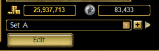

# Loadouts

A loadout is a saved equipment set of a character: the pieces it wears, slot by slot, both weapon sets, and which
weapon set is in hand. Save the gear you wear for one build, wear another, and come back to the first one in a click.

## Where

On the **Equipment** tab, under the gold of the character statistics, the whole width of the statistics (the **Edit**
button of the character editor, when it shows, is on the line below):

- The box lists the character's loadouts: click it to choose one.
- **[+]** records the gear worn now as a new loadout. TQVault asks a name, as for **Duplicate Character**; two loadouts
  of a character cannot have the same name (case is ignored).
- The gold arrow (**Load**) wears the loadout chosen in the box; it is grey when there is nothing to load or the
  character is read-only.
- A right click on the bar gives every action: **Load**, **Update with the gear worn now** (asks first), **Rename**,
  **Copy** (the same pieces under another name), **Delete** (asks first) and **Add**.

## What Load does

- A piece you wear that is **exactly** the loadout's (same item, same affixes, same relics or charms with the same
  bonus and pieces, same seed) stays on you. Worn in another slot (rings swapped, weapon sets swapped), it just moves to
  its slot.
- The other loadout pieces are put on as copies of the saved ones.
- The pieces you wear that the loadout does not use are taken off and stored in the **vault bag shown** in the vault
  panel. Only these pieces need room. Without room for all of them, nothing changes and the status line says so: show
  another bag, or make room, and load again.
- The loadout's weapon set is put in hand.
- No requirement is checked: like the game, a piece you cannot use yet stays in its slot without its bonuses.
- Save as usual to write the character and the vault.

A loadout keeps **copies**: an item has nothing that tells it apart from an identical copy, so a loadout does not point
to "your" sword in a vault. Load a loadout while its sword lies in a vault and you get a second sword; take the one in
the vault instead when you want only one.

## Good to know

- The game keeps the character it plays in memory and writes over the save: TQVault asks before **Load** and **Update**
  while the game runs. Change a character only while the game does not play it.
- A **read-only** character only lists its loadouts.
- Modded characters: the pieces are read with the character's mod, like its other items.
- The loadouts are in the [search](ADVANCEDSEARCH.md): a result says the character and the loadout (type *Loadout*);
  clicking it shows the character's equipment with that loadout chosen.
- The loadouts are kept in `TQVaultAE.Loadouts.json` in the character's save folder (`SaveData\Main\_<name>` or
  `SaveData\User\_<name>`), next to `Player.chr`. They follow the character when it is archived, duplicated by
  TQVault (**Duplicate Character**) or backed up with the [Git backup](GITBACKUP.md).
- Steam Cloud does not carry this file: the game's Steam Cloud settings sync its own save files by file type, and a
  `.json` file is not one of them (checked on a Steam install: the character's save files were synced after the TQVault
  files were written, the TQVault files were not). Steam leaves the file alone; it simply stays on the computer where
  the loadouts were made. To have them on another computer, use the [Git backup](GITBACKUP.md).
