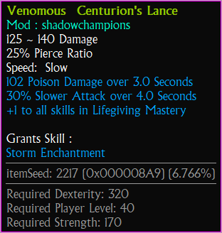

# Mods (custom maps)

TQVaultAE shows your modded characters and their items with their own mod's data, next to your regular characters, in
the same session. Mod items keep their mod when you store them in a vault, so they look right whatever character is
shown.

The technical details (link file, data rules, vault file format) are in [MODLINK.md](MODLINK.md).

---

## Table of contents
* [Link a character to its mod](#LinkCharacter)
* [The character list](#CharacterList)
* [Incomplete items](#Incomplete)
* [Items linked to a mod](#ItemLink)
* [Vaults linked to a mod](#VaultLink)
* [Which link an item gets](#Rules)
* [Sharing items](#Sharing)
* [Good to know](#GoodToKnow)

---

### Link a character to its mod
Titan Quest keeps the characters of custom maps (mods) in `SaveData\User`, but nothing in their save files says which
mod they were played with. The link tells TQVaultAE.

Select the character, then open **Mod link...** from the character menu (the tools button next to the character list).
The dialog lists the installed mods: legacy custom maps and Steam Workshop items.

- **Suggest** looks for the records the character uses that the base game does not have, and selects the installed mod
  that has most of them. It never links on its own.
- **Link** links the character to the selected mod; **Unlink** removes the link.

The character is then loaded with its mod's data. A character that is not linked, or linked to a mod that is no longer
installed, is loaded with the base game data.

_**Note:** the link is a small file in the character's save folder (`TQVaultAE.ModLink.json`). The game ignores it, and
it follows the character when you duplicate or archive it._

---

### The character list
A modded character shows its mod in brackets beside its name, and on the right of its tags line a **Modded** tag with
the link state:

- **Linked** (green): loaded with its mod's data.
- **Not linked** (yellow): no link yet, loaded with the base game data.
- **Not installed** (red): linked to a mod that is no longer installed.

---

### Incomplete items
When an item names records that the loaded data does not have (typically a mod item read with the base game data), its
tooltip says so under its name and lists the missing records. A missing name part shows the record's file name.

An item whose base record is missing has no picture: it shows as a warning tile in one cell (top right), so you can
still find it, move it and read its tooltip.

Link the character to its mod, or link the item itself (below), and the item shows in full.

---

### Items linked to a mod
An item can be linked to a mod. Its records are then read from that mod's data first, then from the base game's,
whatever character or map is shown: picture, size, name, stats and tooltip. The tooltip names the mod under the item's
name.

The items of a linked character that the base game does not know are linked to its mod when the character is loaded.
You can also choose an item's mod yourself: right-click it, then **Modded**. The mod that has the item's records is
marked **(suggested)**; a record found in several mods marks each of them, and **(suggested 1/3)** tells that a mod has
only some of them.

The link follows the item inside TQVaultAE: moved, copied, stored in a vault, relics taken out of it.

---

### Vaults linked to a mod
A whole vault can be linked to a mod: open the vault tools button next to the vault list, then **Modded vault**. The
suggestion there looks at all the vault's items.

The vault list shows the mod in brackets after the vault's name. The vault's items are read with the mod's data first,
then the base game's, even when a regular character is shown:

---

### Which link an item gets
An item either has a link of its own, or follows the link of the vault holding it.

- **Its own link** stays with the item: when the vault's link changes, when the item leaves the vault, when it is
  exported.
- **Following the vault**: base game items, and items that the vault's mod does not complete, take the vault's new
  link when it changes.

An incomplete item gets a mod as its own link as soon as that mod resolves all its missing records:

- when its character is loaded linked to that mod;
- when its vault is linked to that mod;
- when it is put in a vault linked to that mod: dropped, moved with **Move Item To**, imported or pasted.

Once resolved, the item takes its real size (a one-cell warning tile may become a 1x5 lance). Dropped by hand, it stays
where you dropped it, or stays incomplete when it would overlap another item. Put there any other way, it moves to the
first free spot of the bag.

Choosing a mod in an item's **Modded** menu always gives it its own link.

---

### Sharing items
[Exports](IMPORT_EXPORT.md) keep the links:

- an item, items or a tab: each item's mod;
- a vault: the vault's mod, and each item's own link.

Importing a vault (as a new vault, or replacing the vault shown) brings both back. A vault export without a mod keeps the
link of the vault it replaces, and its items follow it.

---

### Good to know
- The game's character files cannot hold an item's link: for an item kept in a character, a link chosen by hand is lost
  when the character is read again. Store it in a vault to keep it.
- An item linked to a mod that is not installed is read with the shown character's data, and shows incomplete when that
  data lacks its records.
- The first time a mod's data is needed, it takes a moment to load (about a second for a large mod); it then stays
  loaded for the session.
- Mods are matched by their folder name, as in the character link.
