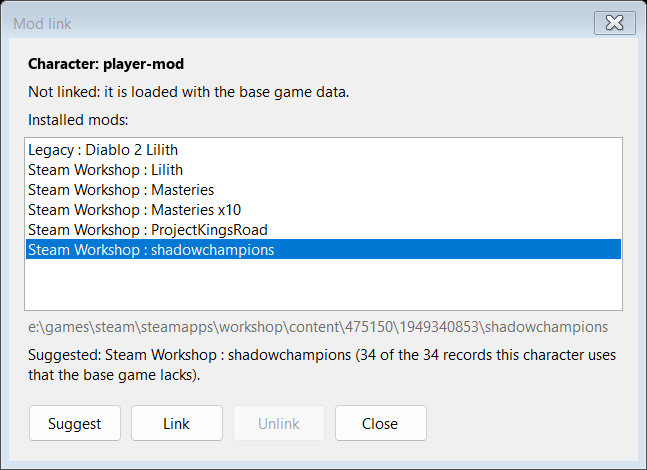
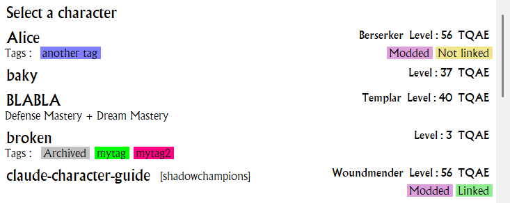
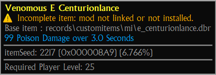
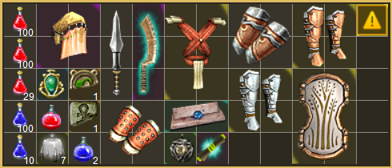
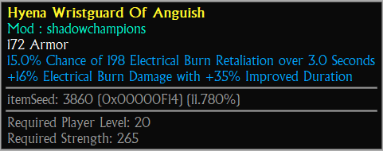
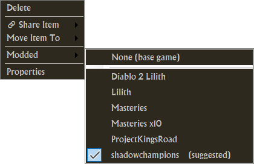
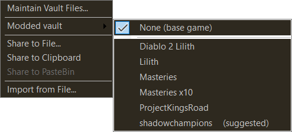
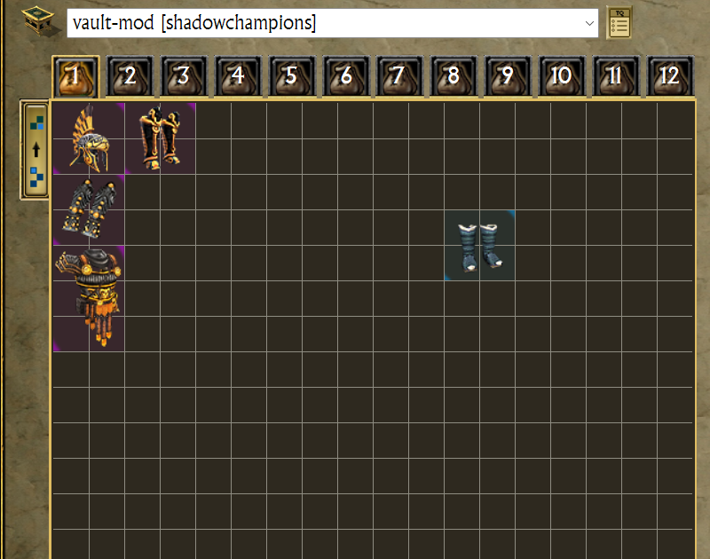

# Mods (custom maps)

TQVaultAE shows modded characters, items and vaults with their own mod's data, next to regular ones, in one session.
Technical details: [MODLINK.md](MODLINK.md).

* [Link a character](#LinkCharacter)
* [Incomplete items](#Incomplete)
* [Link an item](#ItemLink)
* [Link a vault](#VaultLink)
* [Rules](#Rules)

---

### Link a character
Character menu > **Mod link...**; the entry only shows for a character of a custom map. **Suggest** picks the installed
mod that has the character's unknown records; **Link** (or a double click on a mod) saves the choice, **Unlink** removes it.

The character list shows the mod and the link state: **Linked**, **Not linked** or **Not installed**.

---

### Incomplete items
An item whose records the loaded data lacks says so in its tooltip. Without its base record, it shows as a warning tile.

---

### Link an item
Every item is read with its own map: a mod's data (then the base game's), or the base game's, whatever character is
shown. Its tooltip names the mod. An item without a link of its own takes the map of its vault or character.

Right-click a vault item > **Modded** to choose it. **(suggested)** marks the mods having the item's records;
**(suggested n/m)** marks a mod that has only n of its m records. Character items have no such menu: their files cannot
keep the choice.

---

### Link a vault
Vault tools button > **Modded vault**. The vault list shows the mod, and the vault's items use its data.

---

### Rules
- An item has its own link, or takes its container's: its vault's, or its character's.
- An item taken from a character to a vault keeps the data the game reads it with: its character's map becomes its own
  link.
- Nothing is guessed: an item never gets a link because a mod has its records. Link it with **Modded**, where the
  suggestions help.
- Read with another mod, an item that takes its real size and no longer fits moves to a free spot of its tab. Dropped
  by hand or given a link with **Modded** without room in the tab, it is refused, and a message invites you to use
  another tab. Moved, imported or relinked, it may go to another tab of the vault; without any room, it keeps its
  previous link, and a message names it.
- The link follows the item (moves, copies, removed relics) and is kept by [exports](IMPORT_EXPORT.md). An import drops a
  link to a mod that is not installed and names it.
- Character files cannot store an item's link: it lasts until the character is read again. Keep linked items in a vault.
- A Steam Workshop mod and a custom map of the same folder name are two mods: the menus and the dialog show where each
  comes from. A vault or a character named by that name alone (files of earlier versions) uses the Steam Workshop one,
  and the notification line says so: choose the mod again to keep the other.
