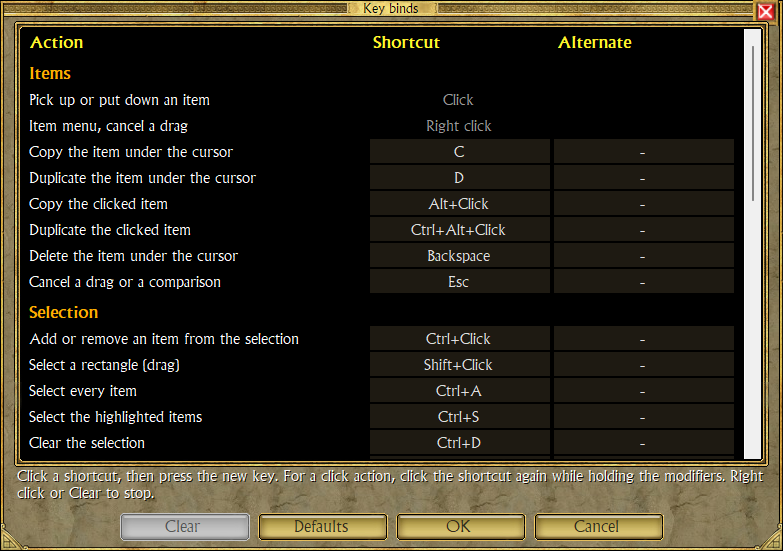

# TQVaultAE Keyboard Shortcuts

Every shortcut below can be changed: see [Changing the shortcuts](#changing-the-shortcuts). The tables give the defaults.

## General

| Shortcut | Action |
|---|---|
| <kbd>CTRL</kbd>+<kbd>C</kbd> | Export selected item(s) to clipboard |
| <kbd>CTRL</kbd>+<kbd>V</kbd> | Import item(s) from clipboard or PasteBin URL |
| <kbd>CTRL</kbd>+<kbd>F</kbd> | Open search form |
| <kbd>CTRL</kbd>+<kbd>+</kbd> | Zoom the whole window in by 10% (up to 200%) |
| <kbd>CTRL</kbd>+<kbd>-</kbd> | Zoom the whole window out by 10% (down to 40%) |
| <kbd>CTRL</kbd>+<kbd>Home</kbd> | Back to the default zoom (100%) |
| <kbd>F5</kbd> | Redraw the panel under the mouse |
| Mouse wheel | Previous / next vault in the vault list |
| <kbd>SHIFT</kbd> held while restoring the window | Back to the default zoom (100%) |

## Selection

| Shortcut | Action |
|---|---|
| <kbd>CTRL</kbd>+<kbd>A</kbd> | Select all items of the bag under the mouse, in any panel |
| <kbd>CTRL</kbd>+<kbd>S</kbd> | Select all [highlighted](HIGHLIGHT.md) items of the bag under the mouse |
| <kbd>CTRL</kbd>+<kbd>D</kbd> | De-select all selected items |
| <kbd>CTRL</kbd>+click | Activate multi selection |
| <kbd>SHIFT</kbd>+drag | Activate mouse lasso for multi selection |

## Item Manipulation

| Shortcut | Action |
|---|---|
| <kbd>BACKSPACE</kbd> | Deletes currently highlighted item |
| <kbd>C</kbd> | Copies currently highlighted item and **randomizes the item seed** on the new item |
| <kbd>D</kbd> | Duplicates currently highlighted item and **keeps the same item seed** on the new item |
| <kbd>ALT</kbd>+click | Copies the clicked item into the mouse cursor and **randomizes the item seed** on the new item |
| <kbd>CTRL</kbd>+<kbd>ALT</kbd>+click | Duplicates the clicked item into the mouse cursor and **keeps the same item seed** on the new item |
| <kbd>&#8592;</kbd> | Moves currently highlighted item(s) to vault panel |
| <kbd>&#8594;</kbd> | Moves currently highlighted item(s) to player/secondary vault panel |
| <kbd>&#8595;</kbd> | Moves currently highlighted item(s) to stash panel |
| <kbd>ALT</kbd>+<kbd>W</kbd>/<kbd>A</kbd>/<kbd>S</kbd>/<kbd>D</kbd> | Move selected items one square over |
| <kbd>ESC</kbd> or right-click, while dragging | Cancels the drag: the item goes back where it was |
| Left-click, after the item menu's **Compare** | Compares the item clicked, in any panel, with the first one (see [Item comparison](ITEMCOMPARE.md)) |
| <kbd>ESC</kbd> or right-click, after **Compare** | Cancels the comparison selection |

"Currently highlighted item" is the item under the mouse cursor. <kbd>BACKSPACE</kbd>, <kbd>C</kbd> and <kbd>D</kbd> act on that item only, never on the selection.
<kbd>C</kbd>, <kbd>D</kbd> and their clicks need the "Allow Item Copying" setting; without it the clicks pick up the item as a
plain click does.
While the secondary vault is shown, <kbd>&#8594;</kbd> sends to the secondary vault and <kbd>&#8595;</kbd> does nothing.

## Forge

| Shortcut | Action |
|---|---|
| <kbd>ENTER</kbd> or <kbd>SPACE</kbd> | Forges, like the Forge button (see [Forge](FORGE.md)) |

The character editor has its own mouse shortcuts, see [Character editor](CHAREDIT.md); the <kbd>SHIFT</kbd> of its
"every point at once" clicks can be changed too.

## Sorting

| Shortcut | Action |
|---|---|
| Click a sort button | Sorts its bag with the chosen order (rows and columns alternate at each click) |
| Right-click a sort button | Chooses the order (size, required level, type or rarity) and sorts at once |

Sort buttons: left of the vault's bag, above the character's main inventory and bags, and right of the stash tabs (shown
on the Transfer Area, Storage Area and Relic Vault, not on the Equipment). These two clicks are fixed. With the "Merge relic
shards when sorting" setting on, relic and charm shards are merged first. A read-only character's bags and Storage Area
are not sorted.

## Bulk Transfer

- <kbd>CTRL</kbd>+click — Multi-select items to transfer
- Right-click — bulk item transfer

## Changing the shortcuts

**Configure** → **Key binds...** lists every key and mouse binding of TQVaultAE. Each action has a shortcut and an
alternate:

- Click a shortcut, then press the new key (with <kbd>CTRL</kbd>, <kbd>SHIFT</kbd> or <kbd>ALT</kbd> if you want).
- For a click action (copy or duplicate by click, selection, "every point at once"), click the shortcut, then click it
  again while holding the modifiers.
- Right-click the shortcut to stop, **Clear** to remove it, **Defaults** to bring every shortcut back.
- Two actions that share a shortcut are shown in red and **OK** stays disabled until one is changed.
- The mouse buttons, the mouse wheel and <kbd>ALT</kbd>+<kbd>F4</kbd> are shown greyed: they cannot be changed.
- Actions turned off by a setting are greyed too, with the setting to tick in their tool tip and under the list: copy and
  duplicate need "Allow Item Copying", the character editor's clicks need "Allow Character Editing Features". Their
  shortcuts can still be changed; they work once the setting is ticked.

The changes take effect when you press **OK** in the settings, without a restart. They are saved in `UserConfig.xml` as
one element listing only the changed actions, for example `<KeyBinds ItemDuplicateClick="Ctrl+Shift+Click" />`.

